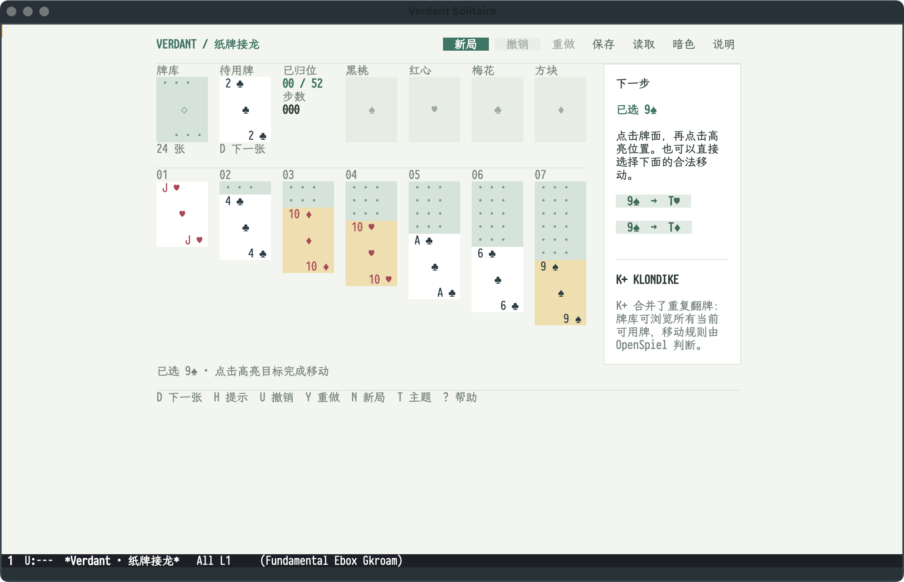
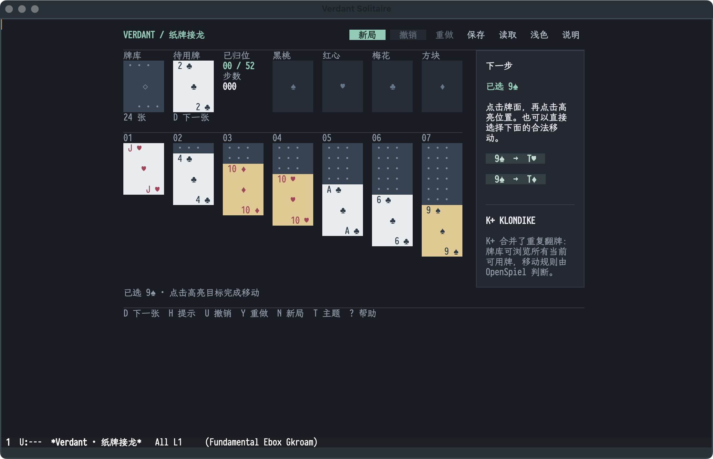

# Verdant Solitaire

A native ETAF card table for K+ Klondike, built as an independent
[GameKit](https://github.com/emacs-taf/etaf-gamekit) application.
OpenSpiel owns the rules, legal moves, chance outcomes and undo/redo history;
this application owns the presentation, selection and the launch command.

K+ Klondike folds repeated draws into the currently available waste-card
choices. It is not a Windows Klondike rules emulator.





## Capabilities

- One Klondike table whose rules, hints and undo/redo history come from the
  OpenSpiel engine, not from a local rule reimplementation.
- Ivory/sage and graphite palettes; switching themes preserves the deal.
- New deal, save, load and help from the toolbar; the table adapts to the
  window it is displayed in.

## Prerequisites

| Requirement | Why | Check |
| --- | --- | --- |
| Emacs 29.1 or newer | the ETAF runtime | `emacs --version` |
| `ecss`, `ebox`, `etaf`, `etaf-ui` | the framework and the `etaf-playing-card` component | every root entry is on `load-path` |
| `etaf-gamekit` and its OpenSpiel backend | rule engine, game instance and state publication | `make -C etaf-gamekit engine-openspiel GAMEKIT_PYTHON=python3.11` |
| Python 3.11 or newer | the OpenSpiel runtime | `python3.11 --version` |

## Installation

```sh
git clone https://github.com/emacs-taf/ecss.git
git clone https://github.com/emacs-taf/ebox.git
git clone https://github.com/emacs-taf/etaf.git
git clone https://github.com/emacs-taf/etaf-ui.git
git clone https://github.com/emacs-taf/etaf-gamekit.git
git clone https://github.com/emacs-taf/etaf-solitaire.git
make -C etaf-gamekit engine-openspiel GAMEKIT_PYTHON=python3.11
```

Add every provider root and this repository to `load-path`:

```elisp
(add-to-list 'load-path "/path/to/ecss")
(add-to-list 'load-path "/path/to/ebox")
(add-to-list 'load-path "/path/to/etaf")
(add-to-list 'load-path "/path/to/etaf-ui")
(add-to-list 'load-path "/path/to/etaf-gamekit")
(add-to-list 'load-path "/path/to/etaf-solitaire")
(require 'etaf-solitaire)

(global-set-key (kbd "C-c s") #'etaf-solitaire-open)
```

`M-x etaf-solitaire-open` deals a table in the current window.

## Keys

| Key | Action |
| --- | --- |
| Click | pick a face-up card, then a highlighted destination |
| `Tab`, arrows, `RET` | move the focus and activate the focused control |
| `D` | browse the available waste cards |
| `H` | select a legal move's source; it is not a solver or an optimal-move promise |
| `U` / `Y` | undo / redo the preceding or following native action |
| `N` | start a new seeded deal; save first to retain the current one |
| `C-s` / `C-o` (or Save / Load) | save or load an explicit local snapshot |
| `T` | switch between the light and dark palettes |
| `F1` / `?` / 说明 | searchable rules and effective controls in the current buffer |
| `Escape` | clear the selection or dismiss the innermost dialog |
| `Q` | close the game without an implicit save |

The toolbar also offers new deal, save, load and help. Legal moves can be
shown beside the table, and `etaf-solitaire-appearance` selects the opening
palette: `auto`, `light` or `dark`.

## Checks

```sh
make check   # structure, compilation, public behavior scenarios and API boundary
```

GUI appearance and performance are separate acceptance requirements; the
[manual](docs/manual.md) describes the maintained GUI workflow.

## Documentation

- [Playing Verdant](docs/manual.md) — rules, controls, appearance, save and
  recovery.
- [Package entry](etaf-solitaire.el) — the supported API inventory.
- [GameKit](https://github.com/emacs-taf/etaf-gamekit) — the shared game
  framework, its adapters and backend installation.

## License

GPL-3.0-or-later; see [LICENSE](LICENSE).
